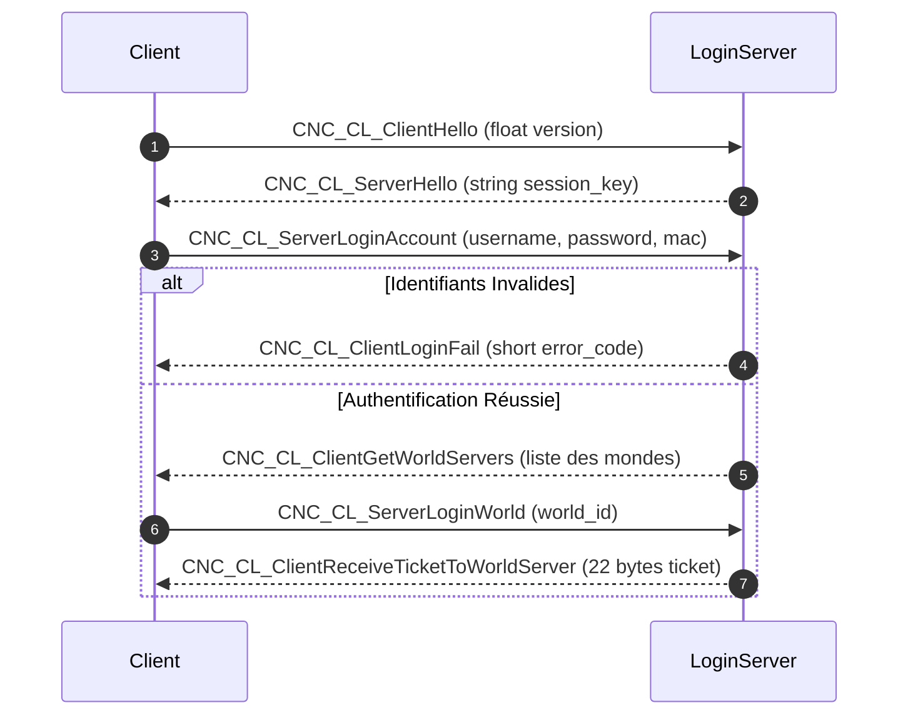

# Plan d'Action & Spécification Rétro-Ingénierie : Eden.Login (LoginServer)

## 1. Contexte & Architecture Native
- **Binaire analysé** : `server_us/LoginServer/LoginServer` (ELF 32-bit x86 C++)
- **Interface C++** : `lapis::CLoginInterface`, `lapis::CNetCommandGeneratorImpl`
- **Table de commandes** : `lapis::InitLoginCommandTable`
- **Ports par défaut** : Port 5100 / 6543 (TCP)
- **Bases de données associées** : PostgreSQL `fnaccount` (table `account`) et `fnmember` (table `member`)

---

## 2. Table des Commandes Réseau (Opcodes)

| Opcode | Nom Commande Native | Direction | Description |
|---|---|---|---|
| `0x0000` (0) | `CNC_CL_ServerHello` | Serveur -> Client | Envoi de la clé de session/chiffrement |
| `0x0001` (1) | `CNC_CL_ServerLoginAccount` | Client -> Serveur | Requête d'authentification (login, pass, mac) |
| `0x0002` (2) | `CNC_CL_ServerLoginWorld` | Client -> Serveur | Sélection du serveur de monde cible |
| `0x0003` (3) | `CNC_CL_ClientHello` | Client -> Serveur | Handshake initial client avec version |
| `0x0004` (4) | `CNC_CL_ClientLoginFail` | Serveur -> Client | Réponse d'erreur d'authentification (code erreur) |
| `0x0005` (5) | `CNC_CL_ClientGetWorldServers` | Serveur -> Client | Liste des mondes disponibles et statut de charge |
| `0x0006` (6) | `CNC_CL_ClientReceiveTicketToWorldServer` | Serveur -> Client | Délivrance du ticket d'accès de 22 octets vers World |

---

## 3. Détail des Structures et Sérialisation Binaire

### Opcode 3 : `CNC_CL_ClientHello` (Client -> Serveur)
- `Version` : `float` (version du protocole client)

### Opcode 0 : `CNC_CL_ServerHello` (Serveur -> Client)
- `SessionKey` : `std::string` (clé de handshake / session)

### Opcode 1 : `CNC_CL_ServerLoginAccount` (Client -> Serveur)
- `Username` : `std::string` (nom de compte)
- `Password` : `std::string` (mot de passe / hash)
- `MacAddressOrToken` : `std::string` (adresse MAC ou jeton périphérique)

### Opcode 4 : `CNC_CL_ClientLoginFail` (Serveur -> Client)
- `ErrorCode` : `short` (code d'erreur : 1 = inexistant, 2 = mot de passe erroné, 3 = banni, etc.)

### Opcode 5 : `CNC_CL_ClientGetWorldServers` (Serveur -> Client)
- `ServerCount` : `short` (nombre de mondes)
- Tableau de serveurs (`WorldServerEntry`):
  - `ServerId` : `short` (ID unique du monde)
  - `ServerName` : `std::string` (Nom affiché dans le client)
  - `ServerIp` : `std::string` (Adresse IP du WorldServer)
  - `ServerPort` : `short` (Port d'écoute du WorldServer, ex: 5200)
  - `CurrentPlayers` : `int` (Nombre de joueurs connectés)
  - `Status` : `short` (0 = Normal, 1 = Chargé, 2 = Plein, 3 = Maintenance)
  - `MinAge` : `short` (Restriction d'âge / niveau)
  - `Flag1` : `short`
  - `Flag2` : `short`
  - `Flag3` : `short`
- `DefaultServerId` : `short` (Dernier monde sélectionné ou recommandé)

### Opcode 2 : `CNC_CL_ServerLoginWorld` (Client -> Serveur)
- `WorldId` : `short` (Identifiant du monde sélectionné)
- `Token` : `std::string` (Paramètre optionnel / code sécurité)
- `Extra` : `std::string` (Paramètre réservé)

### Opcode 6 : `CNC_CL_ClientReceiveTicketToWorldServer` (Serveur -> Client)
- `TicketBuffer` : `byte[22]` (22 octets du ticket cryptographique pour `Eden.World`)

---

## 4. Machine à États et Cycle de Vie Session

---

## 5. Interactions Base de Données (`fnaccount` & `fndb1`)
- **Vérification Compte** : `SELECT id, username, password_hash, is_banned FROM account WHERE LOWER(username) = LOWER(@username)`
- **Création automatique / Enregistrement membre** : Optionnel si `AUTO_CREATE_ACCOUNT` est activé.
- **Mise à jour dernière connexion** : `UPDATE account SET last_login = NOW(), last_ip = @ip WHERE id = @id`
- **Génération Ticket** : Génération d'un tableau d'octets de 22 caractères hexadécimaux inséré / mis en cache pour validation dans `Eden.Ticket` ou `Eden.World`.
