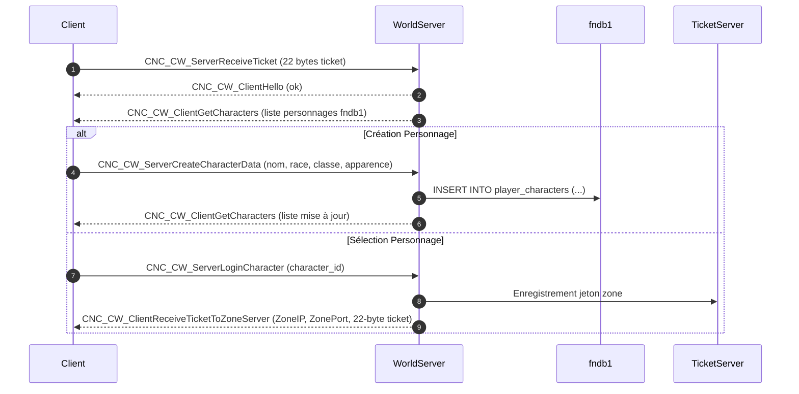

# Plan d'Action & Spécification Rétro-Ingénierie : Eden.World (WorldServer)

## 1. Contexte & Architecture Native
- **Binaire analysé** : `server_us/WorldServer/WorldServer` (ELF 32-bit x86 C++)
- **Interface C++** : `lapis::CWorldInterface`, `lapis::CCharacterManager`
- **Table de commandes** : `lapis::InitWorldCommandTable` (84 commandes CNC_CW_*)
- **Ports par défaut** : Port 5200 / 5712 (TCP)
- **Base de données associée** : PostgreSQL `fndb1` (tables `player_characters`, `player_classes`, `player_items`)

---

## 2. Table des Commandes Réseau Clés (Lobby & Personnages)

| Opcode / Nom Commande | Direction | Description |
|---|---|---|
| `CNC_CW_ServerReceiveTicket` | Client -> World | Envoi du ticket de 22 octets délivré par LoginServer |
| `CNC_CW_ClientHello` | World -> Client | Validation du ticket et confirmation de connexion World |
| `CNC_CW_ClientGetCharacters` | World -> Client | Liste complète des personnages du compte avec apparence |
| `CNC_CW_ServerCreateCharacterNameCheck` | Client -> World | Vérification de disponibilité d'un pseudonyme |
| `CNC_CW_ClientVerifyCharacterName` | World -> Client | Résultat de la vérification de nom |
| `CNC_CW_ServerCreateCharacterData` | Client -> World | Création de personnage (race, classe, genre, visage, coiffure) |
| `CNC_CW_ServerRemoveCharacter` | Client -> World | Suppression / Marquage pour suppression d'un personnage |
| `CNC_CW_ServerLoginCharacter` | Client -> World | Sélection d'un personnage pour entrer en jeu |
| `CNC_CW_ClientReceiveTicketToZoneServer` | World -> Client | Délivrance du ticket Zone (IP, Port, Ticket 22 octets) |
| `CNC_CW_ClientChannelMsg` / `ClientTell` | Bi-directionnel | Messagerie globale, canal monde et chuchotements |

---

## 3. Détail des Structures et Sérialisation Binaire

### `CNC_CW_ServerReceiveTicket` (Client -> World)
- `TicketData` : `byte[22]` (Ticket de session Login)

### `CNC_CW_ClientGetCharacters` (World -> Client)
- `CharacterCount` : `char` (Nombre de personnages, max 8 par compte)
- `LastSelectedSlot` : `short` (Dernier personnage actif)
- Liste des personnages :
  - `CharacterId` : `int` (Identifiant unique du personnage)
  - `Name` : `std::string` (Nom du personnage)
  - `Race` : `short` (Humain = 1, Anuran = 2, Zumi = 3, Ursun = 4, Halfkin = 5)
  - `Gender` : `short` (1 = Homme, 2 = Femme)
  - `ClassId` : `short` (Guerrier, Mage, Prêtre, Voleur, Chasseur, etc.)
  - `Level` : `short` (Niveau du personnage, défaut 1)
  - `ZoneId` : `short` (Identifiant de zone où se trouve le joueur)
  - `FaceId` : `short` (Numéro de visage)
  - `HairId` : `short` (Numéro de coiffure)
  - `HairColor` : `short` (Couleur des cheveux)
  - `SkinColor` : `short` (Couleur de peau)
  - `SlotIndex` : `char` (Numéro d'emplacement 0-7)

### `CNC_CW_ServerCreateCharacterData` (Client -> World)
- `Name` : `std::string`
- `SlotIndex` : `char`
- `Race` : `short`
- `Gender` : `short`
- `ClassId` : `short`
- `FaceId` : `short`
- `HairId` : `short`
- `HairColor` : `short`
- `SkinColor` : `short`

### `CNC_CW_ClientReceiveTicketToZoneServer` (World -> Client)
- `ZoneIp` : `std::string` (Adresse IP de l'instance Eden.Zone, ex: 127.0.0.1)
- `ZonePort` : `short` (Port de l'instance Eden.Zone, ex: 5201 / 10166)
- `ZoneTicket` : `byte[22]` (Ticket d'autorisation d'entrée en zone)

---

## 4. Machine à États du Lobby de Personnage

