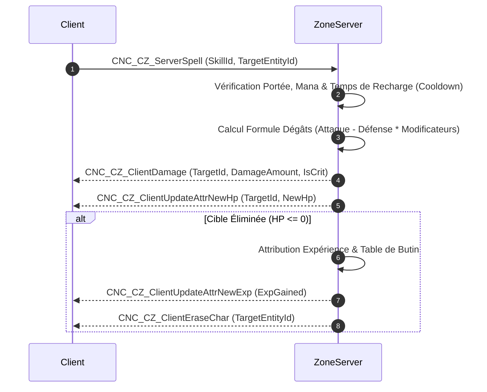

# Plan d'Action & Spécification Rétro-Ingénierie : Eden.Zone (ZoneServer)

## 1. Contexte & Architecture Native
- **Binaire analysé** : `server_us/ZoneServer/ZoneServer` (ELF 32-bit x86 C++)
- **Interface C++** : `lapis::CZoneInterface`, `lapis::CZoneServer`, `lapis::CGridMap`, `lapis::CCharacter`
- **Table de commandes joueur** : `lapis::InitPCCommandTable` (621 commandes CNC_CZ_*)
- **Ports par défaut** : Port 5201 / 10166 (TCP)
- **Base de données associée** : PostgreSQL `fndb1` (tables `player_characters`, `player_items`, `player_skills`, `player_quests`)

---

## 2. Table des Commandes Réseau Fondamentales (Gameplay Loop)

| Commande Réseau | Direction | Description |
|---|---|---|
| `CNC_CZ_ServerHello` / `ClientHello` | Bi-directionnel | Handshake d'entrée en zone et validation du ticket de 22 octets |
| `CNC_CZ_ServerMoveSelf` | Client -> Zone | Envoi du vecteur de déplacement (X, Y, Z, Dir, Vitesse) |
| `CNC_CZ_ClientMoveSelf` | Zone -> Clients | Diffusion du déplacement aux joueurs dans le rayon de visibilité (AOI) |
| `CNC_CZ_ServerTurnSelf` | Client -> Zone | Changement de direction / rotation |
| `CNC_CZ_ClientSeeChar` | Zone -> Client | Apparition d'un joueur/monstre dans la grille spatiale locale |
| `CNC_CZ_ClientDisplayChar` | Zone -> Client | Mise à jour des informations visuelles d'une entité (équipement, buffs) |
| `CNC_CZ_ClientEraseChar` | Zone -> Client | Disparition d'une entité quittant le champ de vision |
| `CNC_CZ_ServerSpell` | Client -> Zone | Lancement de compétence / sort sur cible (TargetId, SkillId) |
| `CNC_CZ_ClientDamage` | Zone -> Clients | Application des dégâts calculés (HP perdus, critique, esquive) |
| `CNC_CZ_ClientUpdateAttrNewHp` | Zone -> Client | Synchronisation de la jauge de points de vie |
| `CNC_CZ_ClientUpdateAttrNewMp` | Zone -> Client | Synchronisation de la jauge de mana / points de classe |
| `CNC_CZ_ServerItemUse` | Client -> Zone | Utilisation ou équipement d'un objet d'inventaire |

---

## 3. Moteur Spatial & Grille Area of Interest (AOI)

### Partitionnement Spatial
- La carte (NodeId, ex: 5 = Colline Fleurie) est divisée en cellules carrées (CellSize = 50.0 unités de jeu).
- Chaque entité (`PlayerEntity`, `MonsterEntity`, `NpcEntity`) est enregistrée dans sa cellule courante.
- Lors d'un déplacement :
  1. Si l'entité change de cellule, les abonnements aux cellules adjacentes sont mis à jour (9 cellules : centrale + 8 voisines).
  2. Les clients des nouvelles cellules reçoivent `CNC_CZ_ClientSeeChar`.
  3. Les clients des cellules quittées reçoivent `CNC_CZ_ClientEraseChar`.
  4. Les paquets de position `CNC_CZ_ClientMoveSelf` ne sont diffusés qu'aux joueurs abonnés aux 9 cellules.

---

## 4. Moteur de Combat & Cycle de Vie Entités

---

## 5. Synchronisation et Persistance DB (`fndb1`)
- **Fréquence** : Asynchrone toutes les 30 secondes ou lors de la déconnexion / changement de zone.
- **Requêtes** :
  - `UPDATE player_characters SET pos_x = @x, pos_y = @y, pos_z = @z, facing_dir = @dir, hp = @hp, mp = @mp, exp = @exp, level = @level WHERE id = @id`
