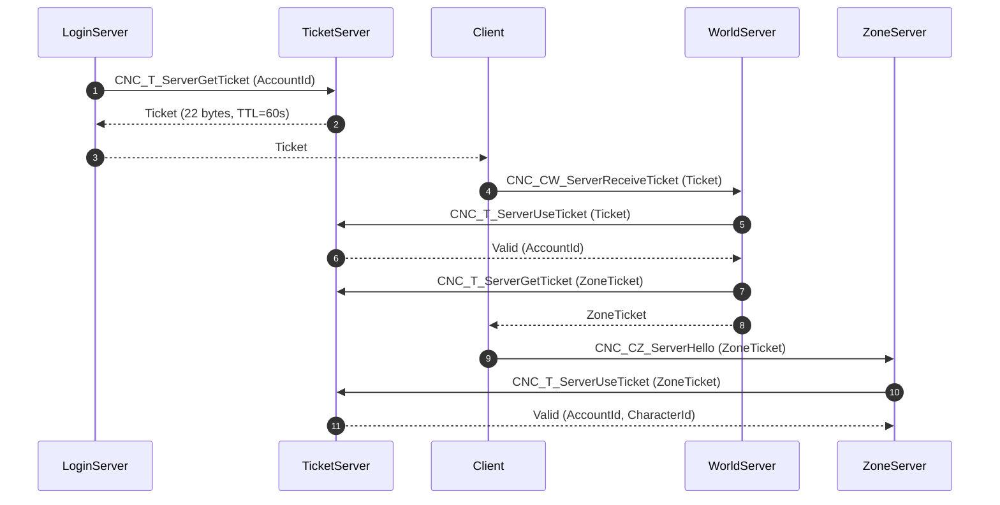

# Plan d'Action & Spécification Rétro-Ingénierie : Eden.Ticket & Eden.Mission

## 1. Contexte & Architecture Native
- **Binaires analysés** : 
  - `server_us/TicketServer/TicketServer` (ELF 32-bit x86 C++)
  - `server_us/MissionServer/MissionServer` (ELF 32-bit x86 C++)
- **Interfaces C++** : `lapis::CTicketInterface`, `lapis::CMissionServer`, `lapis::CGlobalInfo`
- **Ports par défaut** : 
  - TicketServer : Port 2067 / 7777 (TCP)
  - MissionServer : Port 5202 / 7654 (TCP)
- **Base de données associée** : PostgreSQL `fndb1` (tables `guilds`, `guild_members`, `player_mails`, `player_mail_items`)

---

## 2. Spécification TicketServer (Billetterie & Jetons Inter-Serveurs)

### Cycle de Vie d'un Billet
1. **Émission (`CNC_T_ServerGetTicket`)** :
   - Requête : `AccountId` (int), `TargetServerType` (short), `ClientIp` (int)
   - Réponse : `TicketData` (byte[22]), `TTL` (int, par défaut 60 secondes), `Status` (short)
2. **Consommation & Validation (`CNC_T_ServerUseTicket`)** :
   - Requête : `TicketData` (byte[22]), `ClaimingServer` (short), `ClientIp` (int)
   - Réponse : `IsValid` (bool), `AccountId` (int), `CharacterId` (int)
   - *Sécurité anti-rejeu* : La consommation invalide atomiquement le billet pour empêcher toute réutilisation.

---

## 3. Spécification MissionServer (Guildes, Courrier & Événements Globaux)

### Système de Messagerie Interne (Mailbox)
- Envoi de courrier avec pièces jointes (or, objets) :
  - `SenderId` / `SenderName`, `ReceiverName`, `Title`, `Content`, `AttachedGold`, `AttachedItemIds`.
- Persistance dans `fndb1.player_mails`.

### Système de Guildes / Familles
- Gestion des rangs (Chef de guilde, Officier, Vétéran, Membre, Recrue).
- Diffusion du canal de discussion de guilde à travers toutes les instances de zones actives (`CNE_MW_MissionServerTextExCmdRemoteZone`).

---

## 4. Machine à États Inter-Serveurs

