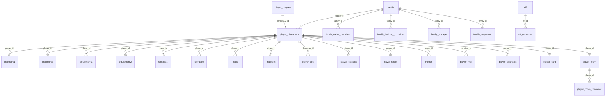

# Base de données Eden — référence humaine

> 4 bases Postgres (`eden_server-postgres-1`). Ce document décrit
> **l'utilité de chaque table en langage de jeu**, si le serveur C#
> l'utilise, et comment les tables se relient.
>
> Légende statut C# : ✅ utilisée · 💤 native mais pas encore portée
> · 🏠 table maison (inventée par nos migrations, pas du schéma natif)
> · 🗄️ `_old` = backup natif · 👁️ vue SQL.

## Vue d'ensemble des bases

| Base | Rôle natif | Contenu |
|---|---|---|
| `fndb1` | **Base de jeu** — tout l'état du monde | persos, inventaires, guildes, classements, quêtes… |
| `fnaccount` | Base comptes + boutique | login, item mall, mondes, achats en attente |
| `fnmember` | Base billing/membre Aeria | sessions billing, soldes points |
| ~~`fnmember1`~~ | ~~Doublon presque identique de `fnmember`~~ | **SUPPRIMÉE** (audit 2026-10-30 : aucun service ne s'y connecte ; backup `Database/backups/fnmember1.sql`, drop auto `Database/011-drop-fnmember1.sql`) |

## Schéma de relations (fndb1)

Toutes les tables « items » (`inventory*`, `equipment*`, `storage*`,
`bags`, `mailitem`, `family_storage`, `elf_container`,
`farm_container`, `collection`, `auction`, `player_room_container`)
partagent **le même schéma natif** : `id` (serial global unique),
`item_id` (template S_Item), durabilité, maker, identify, sockets
`embedded_*`, combos `combo_id`/`extra_combo*`, `strengthen`,
`bind`… Le natif alloue `id` en max(id)+1 sur l'ensemble de ces
tables — notre `ItemSerialAllocator` reproduit ça.

---

## fndb1 — base de jeu (156 objets)

### Personnage — cœur

| Table | Utilité en jeu | Statut |
|---|---|---|
| `player_characters` | **LE perso** : nom, position, classe, race, apparence, level, HP/MP, or, famille, node… | ✅ |
| `player_classlist` | Les N classes du perso (niveau/exp/points de chaque classe apprise) | ✅ |
| `player_classes` | 🏠 variante maison classes (une ligne par classe jouée) | ✅ |
| `custom_class_data` | Les 3 classes personnalisées (spécialisées — armure + 8 sorts + arme choisis) | ✅ |
| `player_license` | Certificats de classe équipés (les "licences" qui unlock des sorts) | ✅ |
| `player_spells` | Sorts/buffs actifs du perso (enchants persistants) | ✅ |
| `player_spellcards` | Cartes de sorts apprises (le système de cartes par classe) | 💤 |
| `player_life_skill` | Métiers appris (racial crafts : exploitation, mélange…) + exp | ✅ |
| `player_works` | Les 11 ordres de travail en cours (métiers raciaux : farm/mine/forge du hall) | ✅ |
| `advanced_ability` | Capacités avancées (AA points — aptitudes post-cap) | ✅ |
| `player_destiny_road` | **Route du destin** — mini-jeu de dés quotidien (cases, buffs) | ✅ |
| `character_stats` | 🏠 stats STR/DEX/CON/INT/PSY/AGI base+bonus | ✅ |
| `player_node_times` | Compteur d'entrées par nœud (plages natives [100,300)∪[600,900) — limite journalière des trials 655+, push 563) | ✅ |
| `new_player_guide*` | Tutoriel/flèches guide débutant (flags "vu") | 💤 (3 versions) |
| `reset_pc` | Tampon natif de re-création de perso | 💤 |
| `class_lifelong` | Succès "à vie" par classe (kills territoire/colosseum…) | 💤 |
| `class_progression` | Table maison de progression classe | 💤 |
| `class_spells` | Table maison sorts par classe | 💤 |
| `class_talents` | Table maison talents | 💤 |

### Inventaires & items

| Table | Utilité | Statut |
|---|---|---|
| `inventory1` | Sac principal (sac 0) | ✅ |
| `inventory2` | Sacs supplémentaires | ✅ |
| `equipment1` | Équipement porté | ✅ |
| `equipment2` | Second set d'équipement (arme alt.) | ✅ |
| `storage1` | Entrepôt banque | ✅ |
| `storage2` | Entrepôt extension | ✅ |
| `bags` | Contenu des sacs d'extension | ✅ |
| `inventory` | 👁️ vue union inventaires | ✅ |
| `equipment`/`storage` | 👁️ vues unions | ✅ |
| `inventory_slots` | 🏠 tailles/expiration des sacs loués | ✅ |
| `player_items`/`player_bank` | 🏠 variantes simplifiées (legacy dév) | ✅/✅ |
| `item_mall_items`/`item_mall_purchases` | 🏠 catalogue/achats boutique | ✅/💤 |

### Famille (= guilde)

| Table | Utilité | Statut |
|---|---|---|
| `family` | La guilde : nom, chef, niveau, titres, trésor, `house_open` (node du hall) | ✅ |
| `family_cadre_members` | Les cadres (officiers) + leur rang | ✅ |
| `family_building_container` | Bâtiments/NPC placés dans le hall de guilde | ✅ |
| `family_storage` | Entrepôt de guilde (objets) | ✅ |
| `family_storage_log` | Journal des dépôts/retraits entrepôt guilde | ✅ |
| `family_bank` | 🏠 banque de guilde simplifiée | ✅ |
| `family_msgboard` | Panneau de messages de guilde | ✅ |
| `family_schedule` | Planning/annonces de guilde | ✅ |
| `family_emblem` | Historique des blasons | ✅ |
| `family_log` | Journal d'événements guilde | ✅ |
| `family_achievement*` | Succès de guilde + classement | 💤 partiel (`_rank` lu) |
| `familybattle_ranks` | Classement batailles de guildes | 💤 |
| `guilds`/`guild_members` | 🏠 ancien schéma maison — **à purger**, le natif utilise `family` | ⚠️ vestige |

### Social

| Table | Utilité | Statut |
|---|---|---|
| `friends` | Liste d'amis (friend_type : blacklist/demandé/mutuel) | ✅ |
| `player_friends` | 🏠 variante maison | 💤 |
| `player_couples` | Couples/mariage (partner1/partner2, affection, date) | ✅ |
| `lover` | Objet "amoureux" natif (coins, points, messages) | ✅ |
| `player_card` | **Carte joueur** (profil social : signe, région, humeur, likes) | ✅ |
| `player_appellation` | Titres débloqués du perso | ✅ |
| `player_evaluate` | **Records personnels des trials** (gladiator 655+) : meilleur score/temps/grade par nœud — règle native : score ↑, à égalité temps ↓ (DB) / temps ↑ (mémoire zone → 608) | ✅ |
| `team_evaluate` | **Historique des runs de trial** : leader, node, score, temps, grade + `team_mem_id1..10` — alimente le rang 600 | ✅ |
| `message_board` | Panneau d'affichage personnel | ✅ |
| `victory_declaration` | Déclarations de victoire de guilde | 💤 |

### Sprite / familier ("Elf" natif = le sprite compagnon)

| Table | Utilité | Statut |
|---|---|---|
| `elf` | Le sprite compagnon (niveau, humeur via stats, sorts de combat/fusion) | ✅ |
| `player_elfs` | 🏠 liste simplifiée des familiers du perso | ✅ |
| `elf_container` | Inventaire/objets du sprite | ✅ |
| `elf_work` | Travaux du sprite (missions craft/minage du salon) | 💤 |
| `farm` + `farm_*` | **Ferme du sprite** (Salon sprite : parcelle, votes, interactions, messages) | 💤 (sauf `farm_container`) |

### Économie

| Table | Utilité | Statut |
|---|---|---|
| `auction` | Objets à l'hôtel des ventes (schéma item complet) | ✅ |
| `auction_view_by_*` | 👁️ 8 vues de tri (prix/niveau/qualité/due_date ↑↓) | 👁️ |
| `active_auctions`/`active_trades`/`auction_history` | 🏠 variantes maison | ✅ |
| `special_coins` | Monnaies spéciales du perso (12 compteurs — jetons event) | ✅ |
| `gold_log`/`bind_gold_log` | Logs or/or lié par tranches de level (stats) | 💤 |

### PvP / classements / events

| Table | Utilité | Statut |
|---|---|---|
| `battlefield_career`/`battlefield_month` | Stats champs de bataille (carrière + mensuel) | 💤 |
| `colosseum_ranking` | Classement Colisée (wins/kills par type) | ✅ |
| `gladiator` | Équipes gladiateurs 3v3 du Colisée | ✅ |
| `classpk_rank` | Tournoi par classe (ClassPK) | ✅ |
| `battle_royale_rank` | Classement battle royale | ✅ |
| `greedy_island_rank`/`_today`/`_yesterday` | Classement Île Cupide (event loot PvP) | ✅ |
| `player_achievement_rank` | Classement succès joueurs (agrégé) | ✅ |
| `player_town_achievement_month`/`monster_kill_achievement_month` | Succès mensuels | 💤 |
| `territory_war` | Possession des territoires par les guildes | 💤 |
| `statues_scenes` | **Statues des joueurs #1** posées en ville | 💤 |
| `familybattle_ranks` | Bataille de guildes | 💤 |

### Quêtes & missions

| Table | Utilité | Statut |
|---|---|---|
| `final_mission_state1/2` | États de quêtes finales (2 moitiés du blob) | ✅/💤 |
| `final_mission_state_v2` | 👁️ vue v2 des quêtes finales | 👁️ |
| `personal_mission_states` | États de quêtes personnelles | ✅ |
| `player_mission_complete_num` | Compteur de complétion par quête | ✅ |
| `mission_trace` | Quêtes trackées (le tracker à l'écran, 10 slots) | ✅ |
| `recommend_activities` | Activités recommandées (calendrier du jour) | ✅ |

### Maison perso / collection / habillage

| Table | Utilité | Statut |
|---|---|---|
| `player_room` | Chambre perso (hôtel) : déco, privilèges visite, fête | ✅ |
| `player_room_container` | Meubles/objets posés dans la chambre | ✅ |
| `player_room_old` | 🗄️ backup | 🗄️ |
| `collection` | Galerie/collection d'objets exposés | ✅ |
| `player_closet` | Garde-robe (skins/costumes collectionnés) | ✅ |
| `fast_dress` | **Tenues rapides** — presets d'équipement switch 1-clic | ✅ |
| `shortcut_menu` | Barres de raccourcis par classe (10 slots × pages) | ✅ |
| `character_shortcuts` | 🏠 variante maison raccourcis | ✅ |

### Divers jeu

| Table | Utilité | Statut |
|---|---|---|
| `fortune_bag` (fndb1) | Config des sacs de fortune (loot tables probabilités) | ✅ |
| `player_fortune_bag` | Compteurs d'ouverture par compte | ✅ |
| `lottery`/`new_lottery`/`in_game_lottery`/`pet_lottery` | **Autels Eden Crystal/Gem** — tirages en cours par joueur | ✅/✅/✅/💤 |
| `player_lottery_point` | Points/paliers de loterie par compte | ✅ |
| `player_enchants` | Buffs/enchants actifs persistés | ✅ |
| `prestige` | Prestige (réputation par région) | ✅ |
| `daily_awards`/`daily_awards_set` | Récompenses connexion quotidienne | 💤 |
| `midnight_limit` | Limites journalières reset à minuit | 💤 |
| `transport` | Points de téléport débloqués | ✅ |
| `node_stream` | Config nodes/world | ✅ |
| `serverstatus` | État des serveurs (boot) | ✅ |
| `active_trades` | 🏠 trades en cours | ✅ |
| `login_tickets`/`zone_tickets` | 🏠 tickets login/zone | ✅ |
| `week_update` | Prochaine mise à jour hebdo des contenus | 💤 |
| `mailitem` | Objets joints aux courriers | ✅ |
| `player_mail` | Boîte aux lettres | ✅ |
| `sys_mail_queue`/`rank_award_mail_queue` | Files de mails système/récompenses rang | 💤 |
| `statistics_monster`/`statistics_player` | Statistiques serveur | 💤 |
| `illplugininfo` | Rapports anti-cheat (plugins illégaux détectés) | 💤 |
| `init_errlog` | Log d'erreurs boot natif | 💤 |
| `configuration` | version schéma/dates monde | 💤 |
| `guilds`, `guild_members` | 🏠 à supprimer | ⚠️ |
| `*_old` (~14 tables) | 🗄️ backups natifs | 🗄️ |

---

## fnaccount — comptes & boutique (24)

| Table | Utilité | Statut |
|---|---|---|
| `accounts` | Comptes joueurs (login, mot de passe, temps de jeu santé) | ✅ |
| `character_number` | Nombre de persos par compte+monde | ✅ |
| `worlds` | Liste des mondes/canaux (ip, port, état, charge) | ✅ |
| `fake_worlds` | Mondes factices affichés (ex. "recommandé") | 💤 |
| `itemmall` | Catalogue boutique (item, prix points, promos) | ✅ |
| `itemmall_limit_amount` | Limites d'achat boutique par compte | ✅ |
| `item_receipt`/`item_receivable` | Achats livrables/à livrer en jeu | ✅ |
| `starway` | Config **Voie astrale** (buffs hebdo par thème) | ✅ |
| `lottery`/`new_lottery`/`ingame_lottery` | Config tirages (récompenses par semaine/tour) — **schéma différent** des homonymes fndb1 (état joueur), pas un doublon | ✅ |
| ~~`fortune_bag`~~ | Copie à encodage corrompu de `fndb1.fortune_bag` (authoritative) | 🗄️ `archive.fortune_bag` |
| `exchange_*` | Codes PIN d'échange d'objets | 💤 |
| `crashlog`/`crashmonitor` | Monitoring crashs serveurs | 💤 |
| `gm_tool_accounts`/`gm_tool_log` | Outil GM (comptes + log commandes) | 💤 |
| `time_itemmall_log` | Log achats boutique | 💤 |
| `configuration` | version schéma/login | 💤 |

## fnmember / fnmember1 — billing (14+17)

| Table | Utilité | Statut |
|---|---|---|
| `tb_user` | **Compte billing** (soldes points `pvalues`/`bonus`) | ✅ |
| `currentuser` | Sessions billing actives | ✅ |
| `game_log` | Log connexions/déconnexions + or | 💤 |
| `web_itemmall_log`/`oauth2_*` | Achats via site web / OAuth | 💤 |
| `powerupitem` | Objets "power-up" | 💤 |
| `pus_avg`/`distinctbid`/`age_*` | Statistiques billing | 💤 |
| `gmip`/`gmtool_log` | IPs GM autorisées / log | 💤 |
| `two_pass` | Double auth | 💤 |
| `adminuser`/`admin_pro`/`gameserver`/`ccu_log`/`ppoint_trade_log` | Admin/CCU logs (fnmember1) | 💤 |
| `exchange_*` (fnmember1) | Codes PIN (doublon) | 💤 |

---

## Audit doublons (2026-10-30) — ce qui a été corrigé, ce qui n'en est pas

**Corrigés :**
- **`fnmember1`** : base doublon de `fnmember` (+ tables admin natives
  `adminuser`, `admin_pro`, `ccu_log` 27k lignes, `ppoint_trade_log`,
  `exchange_*`, `gameserver`, `distinctbid`). Aucun service ne s'y
  connectait. → **base supprimée**, backup `Database/backups/fnmember1.sql`,
  drop auto sur installs fraîches via `Database/011-drop-fnmember1.sql`.
- **`fnaccount.fortune_bag`** : doublon exact de `fndb1.fortune_bag`
  (86833 lignes, clés identiques) mais avec les noms en **encodage
  corrompu** — fndb1 fait foi (le C# la lit via `_gameDb`). → déplacée
  dans `fnaccount.archive.fortune_bag` (réversible).

**Pas des doublons (à ne pas "corriger") :**
- `lottery`/`new_lottery` existent dans **fnaccount ET fndb1** avec le
  même nom mais des schémas différents — split natif : fnaccount =
  config des récompenses (week/round), fndb1 = état du tirage par
  joueur. `ingame_lottery` (fnaccount, config) vs `in_game_lottery`
  (fndb1, état) : même chose avec un underscore en moins, c'est natif.
- `*_old` (~14 tables) : **snapshots de rotation natifs** (rangs
  archivés chaque période : battle_royale, classpk, colosseum,
  gladiator, greedy_island, achievement, room, class_lifelong,
  itemmall_old, gm_tool_log_old). Gardées — design natif, pas un bug.
- `auction_view_by_*`, `equipment`, `inventory`, `storage`,
  `final_mission_state_v2` : ce sont des **VUES** SQL, pas des tables.
- Les ~60 tables fndb1 non référencées par le C# sont des **tables de
  features non portées** (farm_*, sys_mail_queue, daily_awards,
  battlefield_*, player_characters_achievement*, collection…) ou des
  logs natifs — elles coûtent rien et serviront aux prochains lots.

## Points d'attention pour la suite

- **`guilds`/`guild_members`** sont des vestiges de nos premières
  migrations : le natif n'a que `family`. `CharacterRepository`
  joint encore `guilds` pour un nom — à migrer vers `family` puis
  supprimer.
- **`player_friends`** (maison) cohabite avec `friends` (natif,
  friend_type 0-3) — le code utilise `friends`.
- **Farm du sprite** (`farm*`, `elf_work`) = le « Salon sprite »
  entier — gros lot de NCIDs non portés.
- **`statues_scenes`** = les statues de joueurs #1 dans les villes —
  lié au lot NCID 161.
- **`territory_war`**, **`battlefield_*`**, **`familybattle_ranks`** =
  guerre de territoire / champs de bataille / bataille de guildes —
  tables déjà prêtes pour les lots Colosseum/Territoire.
