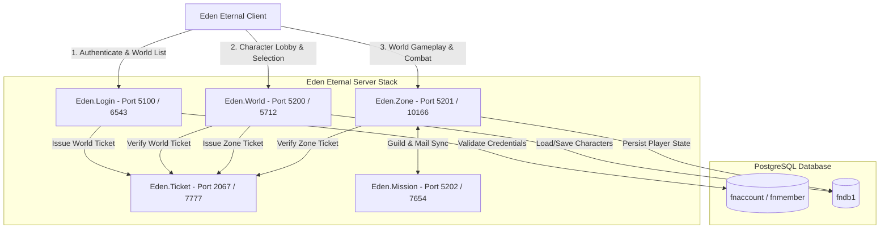

# Requirements

### Overview & Goals
The goal of this project is to completely reconstruct the Eden Eternal (Finding Neverland Online) server suite in modern C# (.NET 8) through systematic binary reverse-engineering of native ELF binaries (`server_us/*`).
The reconstruction follows a strict, sequential service-by-service approach to deliver a fully functional server stack capable of completing the full client gameplay loop:
1. **Client Connection & Handshake**
2. **Account Authentication & World Selection** (`Eden.Login`)
3. **Character Creation, Management & Zone Routing** (`Eden.World`)
4. **World Entry, Movement, Combat & Spatial Entity Management** (`Eden.Zone`)
5. **Cross-Server Token Validation & Social Systems** (`Eden.Ticket` & `Eden.Mission`)

For each phase, dedicated action plan documentation (`docs/action_plans/*.md`) will be produced after decompilation and symbol analysis before deep implementation begins.

---

### Scope

#### In Scope
- **Decompilation & Protocol Extraction**: Systematic analysis of native binaries using Ghidra, REA, and DWARF symbol extraction tools (`tools/extract_all_protocols.py`, `tools/ghidra_scripts/`).
- **Phase 1: `Eden.Login`**:
  - Full handshake, version validation, RSA/session negotiation if applicable.
  - PostgreSQL authentication with `fnaccount` and `fnmember`.
  - World server status listing and ticket emission for `Eden.World`.
- **Phase 2: `Eden.World`**:
  - Account session validation with Login ticket.
  - Character list loading from `fndb1`.
  - Character creation (race, class, appearance validation), deletion, and selection.
  - Generation of zone access tickets and world-level chat/whisper.
- **Phase 3: `Eden.Zone`**:
  - Map and instance initialization.
  - Player spawn and spatial grid (Area of Interest / AOI) management.
  - Movement packets, position sync, collision/boundary checks.
  - Combat engine basics (attributes, skill casting, damage calculations, monster AI).
  - Item and inventory management.
- **Phase 4: `Eden.Ticket` & `Eden.Mission`**:
  - Inter-service ticket validation and expiration handling.
  - Guild management, mail with attachments, and global event broadcasts.
- **Action Plan Documentation**: Structured Markdown documents for each service detailing opcodes, data structures, and state machines.
- **Docker Compose Stack**: Multi-service containerization orchestrating all services with PostgreSQL.

#### Out of Scope
- Game client binary modifications (the server must adapt to standard client protocol).
- Web billing/recharge portal (handled as external mock or standard DB inserts).
- Proprietary anti-cheat kernel drivers.

---

### User Stories
- **As a Player**, I want to launch the Eden Eternal client, log in with my account credentials, see the world list, and select a world server so that I can reach the character select screen.
- **As a Player**, I want to create a new character with custom appearance, select an existing character, or delete a character so that I can manage my roster.
- **As a Player**, I want to enter the game world, load into the starting zone, move around in real time, see other players/monsters, and use skills in combat.
- **As a Developer/Operator**, I want each server service to have clear action plan documentation, clean modular code, unit tests, and Docker deployment configurations so that I can maintain and extend the game.

---

### Functional Requirements
- **FR-1**: Decompile native binaries and document all opcodes, structs, and handlers in `docs/action_plans/`.
- **FR-2**: Authenticate client logins against PostgreSQL password hashes and return accurate server status.
- **FR-3**: Manage character slot rosters, attributes, and appearance with persistent storage in `fndb1`.
- **FR-4**: Handle seamless zone handoff using cryptographic/timed tickets.
- **FR-5**: Broadcast spatial entity movements and state changes to nearby clients using a grid-based AOI system.
- **FR-6**: Support core combat actions, HP/MP synchronization, and monster behavior cycles.
- **FR-7**: Provide inter-service communication between `Login`, `World`, `Zone`, `Ticket`, and `Mission`.

---

### Non-Functional Requirements
- **Performance**: High-throughput asynchronous TCP networking utilizing `System.IO.Pipelines` or asynchronous socket tasks (`NetSession`).
- **Maintainability**: Strict separation of concerns (Core networking, DB repositories, packet serializers, business handlers).
- **Correctness**: Zero serialization drift from native binary struct layouts; 100% adherence to Eden Eternal protocol formats.
- **Containerization**: Single-command startup via `docker-compose up -d`.

# Technical Design

### Current Implementation
The repository currently contains:
- `Eden.Core`: Contains basic binary streaming (`InBinStream`, `OutBinStream`), database entities and repositories (`AccountRepository`, `CharacterRepository`, `WorldRepository`, `UserRepository`), and generated message stubs.
- `Eden.Login`, `Eden.Gateway`, `Eden.World`, `Eden.Zone`, `Eden.Ticket`, `Eden.Mission`: Lightweight executable hosts and skeleton packet dispatchers.
- `tools/`: Reverse-engineering scripts (`extract_all_protocols.py`, `extract_symbols.py`, Ghidra scripts).
- `server_us/`: Native Linux binaries (`login_server`, `world_server`, `zone_server`, `ticket_server`, `mission_server`, `gateway_server`).

---

### Key Decisions
1. **Strict Sequential Implementation Order**:
   - Reconstruct services in dependency order: `Login` -> `World` -> `Zone` -> `Ticket`/`Mission`.
   - Reason: Follows the natural client connection flow and ensures each upstream dependency is solid before downstream features are built.

2. **Decompilation-First Documentation (`docs/action_plans/`)**:
   - Before writing service code, extract the exact binary structures, command tables, and state diagrams into a dedicated action plan markdown file.
   - Reason: Prevents placeholder implementations and guarantees fidelity to native game protocols.

3. **In-Memory Spatial Grid with DB Snapshot Persistence**:
   - `Eden.Zone` maintains active player and monster positions in an AOI grid in memory, persisting deltas and snapshots to PostgreSQL asynchronously.
   - Reason: Minimizes database latency during real-time movement and combat.

4. **Dedicated DTOs for Binary Packets**:
   - Separate network packet DTOs implementing `IPacketMessage` from database entities.
   - Reason: Isolates wire protocol details from internal database schema representations.

---

### Architecture Diagram



---

### Service-by-Service Reconstruction Strategy

#### 1. Eden.Login
- **Decompilation Targets**: `lapis::LoginServer`, `lapis::AccountManager`, packet handlers for opcodes `0x0100`–`0x01FF`.
- **Packet Suite**:
  - `ClientHelloMessage` / `ServerHelloMessage` (handshake and encryption setup).
  - `LoginAccountRequest` / `LoginSuccessResponse` / `LoginFailureResponse`.
  - `WorldListRequest` / `WorldListResponse` (server load and status).
  - `SelectWorldRequest` / `WorldTicketResponse`.
- **Deliverable Documentation**: `docs/action_plans/01-EDEN-LOGIN-PLAN.md`.

#### 2. Eden.World
- **Decompilation Targets**: `lapis::WorldServer`, `lapis::CharacterManager`, opcodes `0x0200`–`0x02FF`.
- **Packet Suite**:
  - `WorldClientHelloMessage` (ticket validation).
  - `CharacterListRequest` / `CharacterListResponse` (roster summaries).
  - `CreateCharacterRequest` / `CreateCharacterResponse` (race, gender, job, hair, face, name checks).
  - `DeleteCharacterRequest` / `DeleteCharacterResponse`.
  - `SelectCharacterRequest` / `ZoneTicketResponse` (zone routing).
  - `ChatMessage` (lobby/world announcements).
- **Deliverable Documentation**: `docs/action_plans/02-EDEN-WORLD-PLAN.md`.

#### 3. Eden.Zone
- **Decompilation Targets**: `lapis::ZoneServer`, `lapis::EntityManager`, `lapis::GridMap`, `lapis::CombatManager`, opcodes `0x0300`–`0x03FF`.
- **Core Components**:
  - `SpatialGrid` / `AOIManager`: 2D/3D partition grid managing visibility radius and entity subscriptions.
  - `PlayerEntity` & `MonsterEntity`: State machines, HP/MP, stats, buffs, and aggro tables.
  - `CombatEngine`: Skill cast verification, cooldowns, formula execution (damage, critical, evasion).
  - `InventoryManager`: Bag slots, equipment, item moves, item uses.
- **Deliverable Documentation**: `docs/action_plans/03-EDEN-ZONE-PLAN.md`.

#### 4. Eden.Ticket & Eden.Mission
- **Decompilation Targets**: `lapis::TicketServer`, `lapis::MissionServer`, `lapis::GuildManager`, `lapis::MailManager`.
- **Core Components**:
  - `TicketServer`: Secure in-memory token cache with short TTL (e.g. 60s), atomic claim, and IP validation.
  - `MissionServer`: Inter-zone guild chat, guild rank updates, mailbox delivery, and global mission broadcasts.
- **Deliverable Documentation**: `docs/action_plans/04-EDEN-TICKET-MISSION-PLAN.md`.

---

### File Structure

```
eden_server/
├── docs/
│   ├── action_plans/
│   │   ├── 01-EDEN-LOGIN-PLAN.md
│   │   ├── 02-EDEN-WORLD-PLAN.md
│   │   ├── 03-EDEN-ZONE-PLAN.md
│   │   └── 04-EDEN-TICKET-MISSION-PLAN.md
│   └── RAPPORT-REVERSE-EDEN-SERVER.md
├── server/
│   ├── Eden.sln
│   ├── src/
│   │   ├── Eden.Core/
│   │   │   ├── Database/
│   │   │   │   ├── Entities/
│   │   │   │   └── Repositories/
│   │   │   └── Networking/
│   │   │       ├── Messages/ (Login, World, Zone, Ticket, Mission)
│   │   │       └── Session/
│   │   ├── Eden.Login/
│   │   ├── Eden.World/
│   │   ├── Eden.Zone/
│   │   ├── Eden.Ticket/
│   │   ├── Eden.Mission/
│   │   └── Eden.Gateway/
│   └── tests/
│       └── Eden.Tests/
├── docker-compose.yml
└── .env
```

---

### Risks & Mitigations
- **Binary Struct Alignment Drift**: C++ compilers pad structs based on compiler flags.
  - *Mitigation*: Verify exact byte lengths of test packets generated by `OutBinStream` against captured or decompiled buffer sizes.
- **Complex Combat Formulas & Status Effects**: Hundreds of skills with variable formulas.
  - *Mitigation*: Extract skill effect tables and formulas directly from native binary data tables (`Data/` or DWARF debug symbols).
- **Concurrency in Zone Spatial Grids**: Race conditions during high entity churn.
  - *Mitigation*: Use thread-safe actor-like or lock-free concurrent structures for AOI grid cells.

# Testing

### Validation Approach
Verification combines unit testing of protocol serialization, end-to-end integration flows simulating client behaviors, and container cluster health verification.

---

### Key Scenarios

#### 1. Authentication Flow (`Eden.Login`)
- Client sends hello -> Server returns hello with server key.
- Client sends `LoginAccountRequest` with valid credentials -> Server verifies against PostgreSQL and returns `LoginSuccessResponse`.
- Client sends `WorldListRequest` -> Server returns world list with online status and population.
- Client selects world -> Server returns valid one-time ticket and target world host/port.

#### 2. Character Management Flow (`Eden.World`)
- Client connects to `Eden.World` and provides world ticket -> Server validates ticket and accepts session.
- Client requests character list -> Server queries `fndb1` and returns character summaries.
- Client creates character -> Server verifies name uniqueness and valid race/class attributes, creates DB record, and returns character details.
- Client selects character -> Server issues zone transition ticket with target `Eden.Zone` IP/port.

#### 3. World Entry & Spatial Movement (`Eden.Zone`)
- Client connects to `Eden.Zone` with zone ticket -> Server spawns character at last recorded coordinates.
- Server broadcasts spawn packet to nearby players within the AOI cell.
- Client sends movement vector -> Server validates speed/coordinates and broadcasts position updates to adjacent cells.

#### 4. Inter-Service Operations (`Eden.Ticket` & `Eden.Mission`)
- Ticket verification across boundaries succeeds once and expires on use or timeout.
- Player sends a guild message -> `Eden.Mission` relays message to all online guild members across all active zones.

---

### Edge Cases
- **Replay Attack / Duplicate Ticket Claim**: Attempting to reuse an already-claimed ticket must immediately fail and disconnect the client.
- **Invalid Character Name / Race Mismatch**: Creating a character with existing name or prohibited race/class combination must return specific error codes.
- **Rapid Cross-Zone Boundary Movement**: Player moving rapidly across AOI cell borders must seamlessly subscribe to new cells and unsubscribe from old cells without packet loss.
- **Database Disconnection Recovery**: Temporary database drops must be gracefully retried without crashing the socket listener.

---

### Test Suite Structure
- `tests/Eden.Tests/LoginTests.cs`: Authentication, password hashing, and world list serialization.
- `tests/Eden.Tests/WorldTests.cs`: Character creation, deletion, selection, and ticket issuance.
- `tests/Eden.Tests/ZoneTests.cs`: AOI grid registration, movement broadcast, and damage math.
- `tests/Eden.Tests/TicketMissionTests.cs`: Ticket issuance, expiration, guild messaging, and mail.

# Delivery Steps

### ✓ Step 1: Reverse-Engineering & Implementation of Eden.Login
The Eden.Login service fully authenticates game clients, manages account credentials against PostgreSQL, and coordinates inter-server routing with accurate packet serialization.

- Run symbol extraction and Ghidra decompilation passes on `server_us/LoginServer/login_server` to map all network opcodes (`0x0100`–`0x01FF`), packet payloads, and crypto/session state machines.
- Create detailed action plan documentation `docs/action_plans/01-EDEN-LOGIN-PLAN.md` documenting reverse-engineered packets, state transitions, and database queries (`fnaccount`, `fnmember`).
- Implement full `LoginPacketHandlers` in `src/Eden.Login/Handlers/` covering client hello, version verification, secure credential verification, world server list queries, world selection, and one-time ticket generation.
- Implement packet serialization models in `src/Eden.Core/Networking/Messages/Login/` with exact binary layouts matching native struct alignments.
- Add unit and integration tests in `tests/Eden.Tests/LoginTests.cs` validating authentication flow and binary stream encoding/decoding.

### ✓ Step 2: Reverse-Engineering & Implementation of Eden.World
The Eden.World service manages the character lobby, handles character creation, deletion, and selection, and coordinates handoff to Zone servers via ticket validation.

- Decompile and reverse-engineer `server_us/WorldServer/world_server` using Ghidra and REA to extract all lobby, character management, and chat opcodes (`0x0200`–`0x02FF`).
- Generate action plan documentation `docs/action_plans/02-EDEN-WORLD-PLAN.md` detailing character data structures, appearance customization fields, class definitions, and zone routing logic.
- Expand `PlayerCharacterEntity` and `CharacterRepository` in `src/Eden.Core/Database/` to support full character attributes, equipment slots, level/exp, and appearance options across `fndb1`.
- Implement complete `WorldPacketHandlers` in `src/Eden.World/Handlers/` for character list queries, character creation validation (name uniqueness, class/race constraints), character deletion, character selection, and zone transition ticket generation (`ZoneTicketResponse`).
- Implement broadcast and direct chat routing mechanisms in `Eden.World` for system announcements and whisper/channel communication.
- Create tests in `tests/Eden.Tests/WorldTests.cs` verifying character lifecycle and ticket generation.

### ✓ Step 3: Reverse-Engineering & Implementation of Eden.Zone
The Eden.Zone service manages active map instances, entity lifecycles, grid-based spatial synchronization, movement, player state, and core combat logic.

- Reverse-engineer `server_us/ZoneServer/zone_server` to extract instance management, map boundary data, movement opcodes (`0x0300`–`0x03FF`), combat formulas, monster AI behaviors, and item inventory packets.
- Produce action plan documentation `docs/action_plans/03-EDEN-ZONE-PLAN.md` covering spatial grid partitioning, entity synchronization algorithms, damage calculation tables, and movement interpolation rules.
- Implement entity and spatial management in `src/Eden.Zone/` including `EntityManager`, `ZoneInstance`, `PlayerEntity`, `MonsterEntity`, and Area of Interest (AOI) grid broadcaster.
- Implement `ZonePacketHandlers` in `src/Eden.Zone/Handlers/` for client zone handshake, position/movement updates, spell/skill casting, damage application, item pickup, and inventory interactions.
- Implement persistence synchronization between memory state and PostgreSQL database for character location, health/mana, inventory, and stats.
- Add unit tests in `tests/Eden.Tests/ZoneTests.cs` for AOI visibility, movement verification, and combat calculation logic.

### ✓ Step 4: Reverse-Engineering & Implementation of Eden.Ticket and Eden.Mission
The Eden.Ticket and Eden.Mission services provide inter-server ticket issuance/validation, guild management, mail systems, global auctions, and cross-zone quest triggers.

- Reverse-engineer `server_us/TicketServer/ticket_server` and `server_us/MissionServer/mission_server` to extract ticket exchange protocols, guild operations (`0x0400`–`0x04FF`), auction house, and mail opcodes.
- Write action plan documentation `docs/action_plans/04-EDEN-TICKET-MISSION-PLAN.md` detailing ticket validation cryptography/timeouts, guild hierarchy, mail storage schemas, and global mission broadcasts.
- Implement full `TicketService` in `src/Eden.Ticket/` supporting secure ticket issuance, multi-server validation, TTL expiration, and replay prevention.
- Implement `MissionPacketHandlers` in `src/Eden.Mission/` handling guild creation/ranks, member rosters, in-game mail with attachments, and global event announcements.
- Add unit tests in `tests/Eden.Tests/MissionTicketTests.cs` covering ticket exchange cycles and guild/mail data operations.

### ✓ Step 5: End-to-End Gameplay Loop Integration & Cluster Validation
The entire server cluster connects seamlessly across the full gameplay loop from client startup to world exploration, packaged with Docker Compose.

- Create end-to-end integration test scenarios simulating client login -> world selection -> character creation -> character entry -> zone movement.
- Update `docker-compose.yml`, `docker-compose.stack.yml`, and environment templates (`.env`) ensuring all microservices (`Login`, `Gateway`, `World`, `Zone`, `Ticket`, `Mission`) start with correct inter-service network topology and PostgreSQL initialization scripts.
- Consolidate reverse-engineering documentation and operational runbooks in `docs/RECONSTRUCTION-GUIDE.md` and `docs/action_plans/SUMMARY.md`.
- Run full solution build (`dotnet build`) and complete test suite (`dotnet test`) across all services.