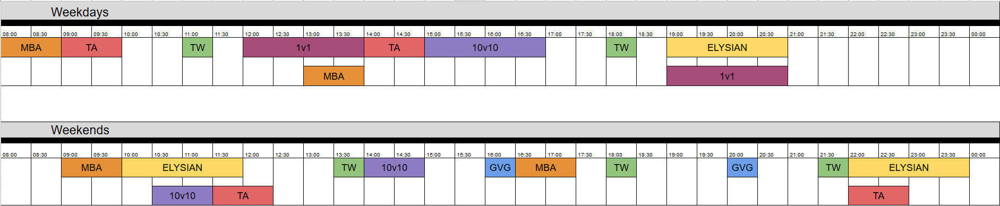

# Patchnote VGN 23 3/5 : planning PVP

> Source : `raw/guides-fr/2017/09/21/traduction-du-patch-vgn-23-34.html` — publié le 2017/09/21 (site WordPress edenfr.wordpress.com)

_Suite de la traduction du patchnote VGN 23. Source :[ici](https://forum.vendettagn.com/index.php?/topic/3101-patch-v23/)._
**Changements PVP**
* * *
On commence par l’information la plus importante : le nouveau planning des instances PVP.

None[image non-redimensionnée [ici](../images/patch23_13.png)]
_Note: Les horaires sont ceux du serveur, que vous pouvez consulter sur le site Vendetta, ou demandez à un GS._
_Note Solen : en gros en semaine, ils maintiennent la GT de minuit et en ajoutent une de 17h à 17h30, horaires GMT+1 de France métropole._
Vous remarquerez que l’arène 3v3 n’est pas sur le planning et c’est parce qu’elle est désormais ouverte 7/24 (sauf une minute de 23h59 à minuit).
**Guerres de territoire (GT ou TW)**
– Les territoires ne sont plus réinitialisés à chaque maintenant.
– Chaque territoire sera mis en jeu deux fois par semaine (voir plus bas).
– Les cristaux sont plus difficiles à dépop (PV inchangés mais plus de résistance).
– La zone procure une réduction de dégâts de 15% supplémentaires.
– La réduction des dégâts critiques passe à 20%.
– Crystal Island Battlefield : Belk fait plus de dégâts et est plus difficile à tuer.
– Flurry Gem Battlefield : le Totem fait plus de dégâts et a une immunité aux transformations.
**Elimination de Guilde (EDG ou GvG)**
– PV des cristaux +50%.
– Réduction des dégâts critiques à 20%.
**Elysian Island**
– Les PV sont désormais au même niveau qu’en GT.
– Les tirs amis dans votre propre groupe sont désactivés (vous ne tuerez plus votre heal accidentellement). _Note : pour le moment, un certain nombre d’aoe touchent encore vos alliés et je tâcherais d’arranger ça plus tard._
– Le renvoi « Gallop Peeper » devient de la résistance physique.
– Le buff « Pulse Ebulience » est désormais utilisable chaque fois que le joueur le souhaite, mais niveau requis 79 ou inférieur.
– Les stats du buff « Pulse Ebulience » deviennent du dégât infligé, du dégât reçu et de la vit dep.
– Correction du pop des boss, pour qu’ils pop toujours.
**Arènes 3v3 / 10v10**
– Les PV sont désormais comme en GT.
– Ajout d’un buff de réduction de dommages.
**Arène de boss**
– Sans changement pour le moment.
**Ile Déserte**
– Désactivée car impopulaire (n’a jamais proc en 3 ans).
– Deviendra une nouvelle instance PVP pour un autre patch.
**Sakura Island**
– Les PV sont désormais comme en GT.
– Ajout d’un buff de réduction de dommages.
**Modification du planning des guerres de territoire**
* * *
Maintenant qu’il y a 16 GT et plus 10, j’ai dû trouver des expédients parce que le nombre de territoires à gagner par guilde restera lui à 3 maximum, pour éviter le côté « on a nos 3 terris alors on vient pas ». Maintenant chaque territoire sera mis en jeu 2 fois dans la semaine donc il y aura en tout 8 territoires à choper. Voici le planning de chaque territoire et sur quel champ de bataille il est en jeu.

**Note : il s’agit du planning régulier. Mais certaines maps ont été remplacées pendant la semaine suivant la mise en place du patch pour que les gens puissent tester plus souvent qu’en temps normal les premières maps inédites depuis 4 ans. Les territoires suivants sont remplacés POUR UNE SEMAINE SEULEMENT :**
– Colline Tranquille
– Monts Arides
– Volcan Avila
**Note additionnelle** : compte tenu de ce nouveau système, j’ai décidé de doubler les récompenses du coffre de territoire obtenu en prenant son salaire et d’y réintroduire les pierres de guerre.
